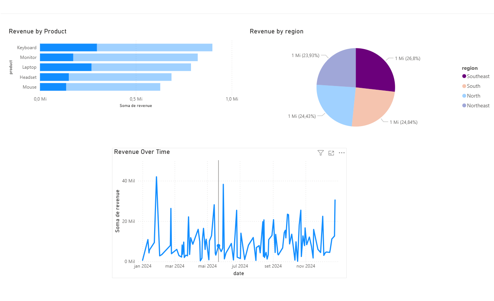
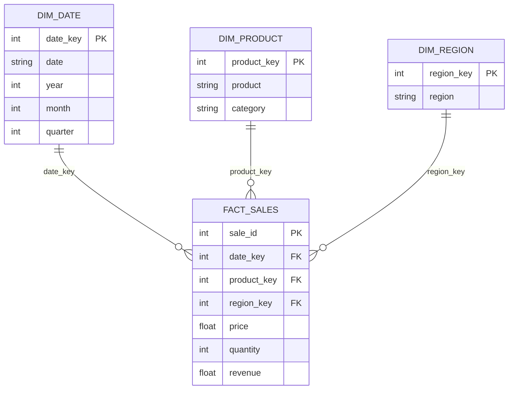

# Sales Data Analysis | Python, SQL & Power BI

Portfolio project exploring **synthetic retail sales** with Python (Pandas), SQLite and Power BI. The original sales dashboard and flat-file analysis are retained. A reproducible **star-schema warehouse** adds practical SQL examples, dimensional modeling and data-quality checks.

> **Scope:** Learning project built from generated data, not production business data. The screenshot below is the **original Power BI dashboard**; it has **not** been rebuilt using the new dimensional model.



## Questions explored

- Which products and regions account for the most revenue?
- How does revenue change over time?
- What percentage of revenue belongs to each category?
- How can a star schema make sales analysis easier to query?

## Stack

| Layer | Technology | Purpose |
| --- | --- | --- |
| Source | CSV | Synthetic sales records (`sales.csv`) |
| Data processing | Python, Pandas | Validate and prepare sales |
| Warehouse | SQLite | Store fact and dimension tables |
| SQL analysis | JOINs, CTEs, window functions | Query trends and rankings |
| Visualization | Power BI | Existing original dashboard |
| Tests | unittest | Reconcile source and warehouse |

## Data limitations

The original CSV has **500 simulated sales** with `date`, `product`, `category`, `price`, `quantity` and `region`. Revenue is `price * quantity`. These numbers are **not real sales performance**.

The existing generator selects product categories and prices independently at random. As a result, the same product can appear under different categories, and some prices are unrealistic. The warehouse deliberately **preserves the input records**: each distinct `(product, category)` combination is a separate dimension member. This limitation is not silently "fixed".

## Star schema



**Grain:** One fact row per original sales record. The source does not contain customer or order identifiers.

## Reproduce

Python 3.10+ recommended. From the repository root:

```bash
python -m pip install -r requirements.txt
python analysis.py
python build_warehouse.py
python -m unittest discover -s tests -v
```

The original `analysis.py` writes to `sales.db`. The new `build_warehouse.py` independently creates `warehouse.db`, without overwriting the original database. You can choose another output path:

```bash
python build_warehouse.py --csv sales.csv --db output/warehouse.db
```

Open `warehouse.db` in a SQLite client and run the statements in [sql/analytics.sql](sql/analytics.sql) **one at a time**:

1. Product/category revenue using dimension joins.
2. Monthly regional revenue using a CTE.
3. Regional revenue ranking using a window function.
4. Category revenue share.
5. Index inspection using `EXPLAIN QUERY PLAN`.

Indexes are defined for foreign keys, but no performance improvement is claimed without benchmarks.

## Checks

The Python pipeline validates column presence, dates, numeric types, positive prices and quantities, non-empty dimension values, integer quantities, and foreign keys. The unit tests check source-to-fact row count, revenue reconciliation and join integrity. Generated `warehouse.db` is ignored by Git.

## Next steps

- Improve the generator with a fixed seed and realistic product categories/prices.
- Connect a **new** Power BI model to the star schema, add DAX measures, and document it.
- Benchmark SQL queries on a larger dataset before making optimization claims.
- Add a GitHub Actions test workflow.

## Author

João Vitor Soska — [GitHub](https://github.com/joaovitorsoska)
